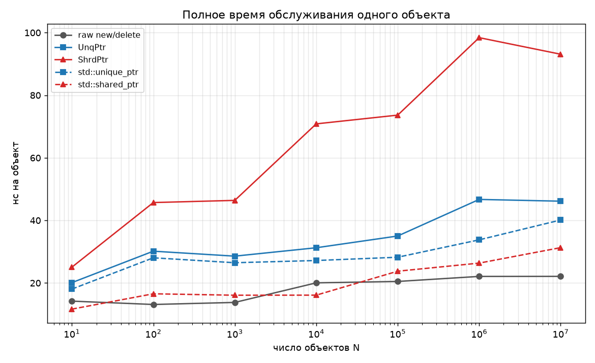
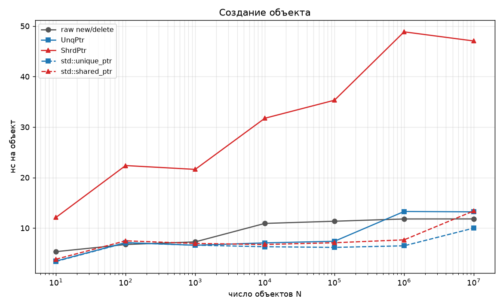
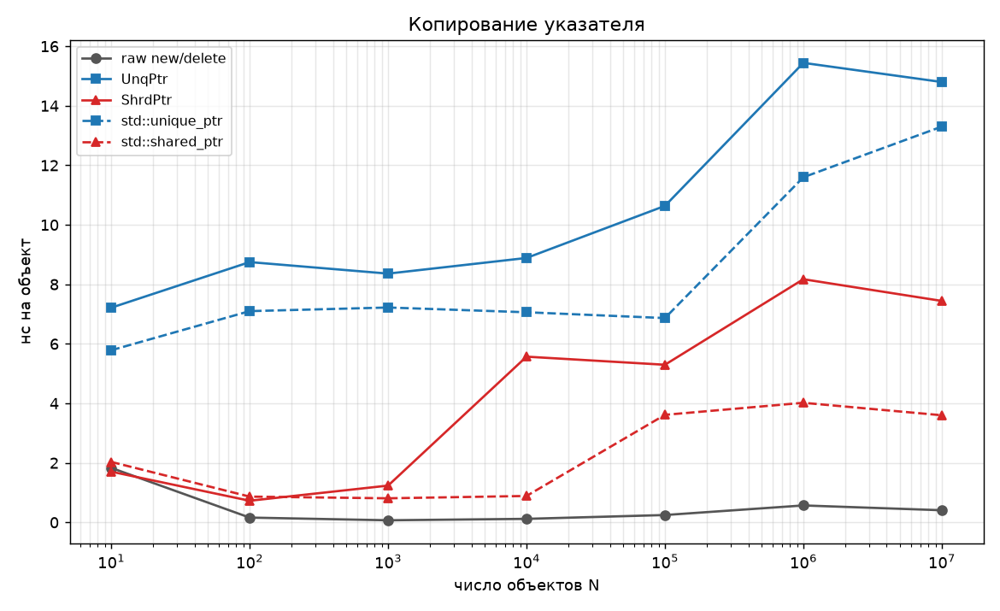
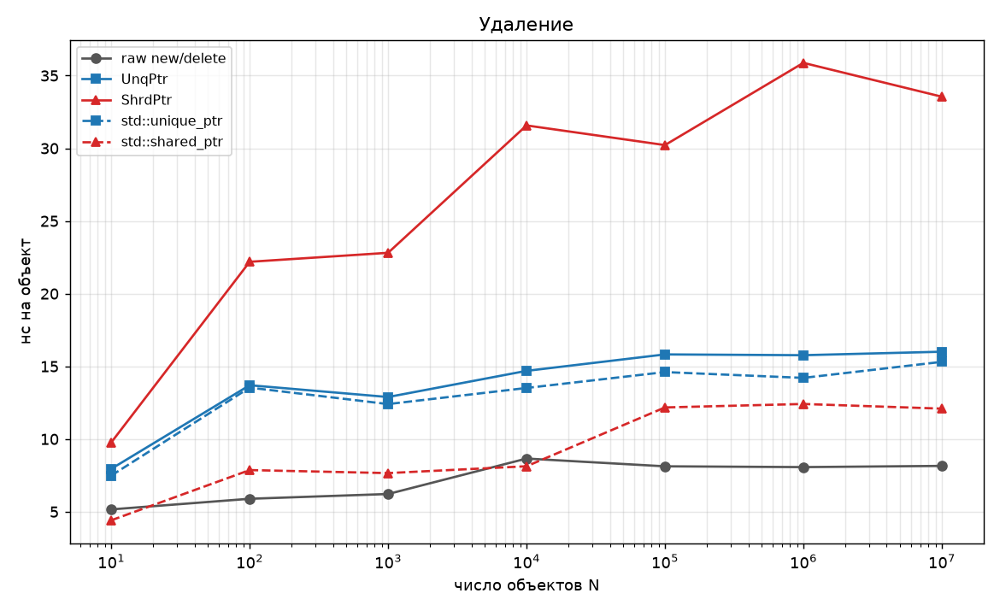
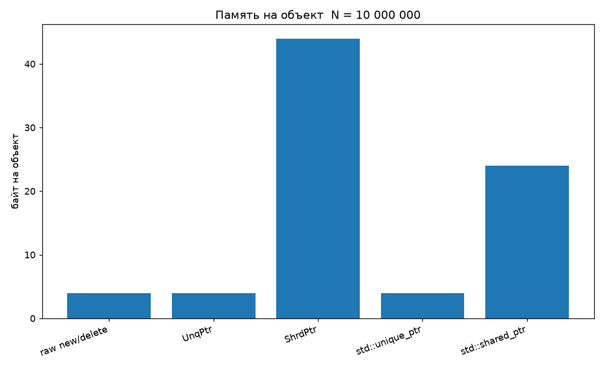
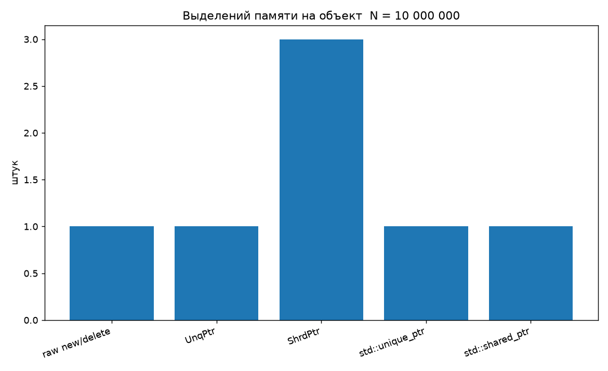

# ДЗ №1 — умные указатели

Реализованы два варианта задания:

- **децентрализованное хранение, вариант 2** — классы `UnqPtr<T>` (ведущий указатель) и `ShrdPtr<T>` (дескриптор), подсчет ссылок ведется только средствами `ShrdPtr` через поле `size_t*`, без отдельного управляющего объекта;
- **схема с арифметикой указателей** — классы `MemorySpan<T>` (массив с доступом только через умные указатели) и `MsPtr<T>` (указатель с безопасной арифметикой).

| Класс | Назначение | Файл |
|---|---|---|
| `UnqPtr<T>` | ведущий указатель, семантика значения | `include/UnqPtr.hpp` |
| `ShrdPtr<T>` | дескриптор, счетчик ссылок `size_t*` | `include/ShrdPtr.hpp` |
| `MemorySpan<T>` | массив, доступ только через умные указатели | `include/MemorySpan.hpp`, `SpanStorage.hpp` |
| `MsPtr<T>` | указатель с безопасной арифметикой | `include/MsPtr.hpp` |
| `Sequence<T>`, `ArraySequence<T>`, `ListSequence<T>` | контейнеры на умных указателях | `include/Sequence.hpp` и далее |

Стандартные умные указатели в реализации не используются — только в нагрузочных тестах для сравнения (`src/Benchmark.cpp`). Все классы шаблонные, подтипизация поддерживается концептом `PointerCompatible<U, T>`, который проверяет, что `U*` неявно превращается в `T*`.

## Сборка

Нужен компилятор с поддержкой C++20 (GCC ≥ 10, Clang ≥ 12, MSVC 19.29+). Сборка проходит без предупреждений при `-Wall -Wextra -Wpedantic`.

Есть два равнозначных способа; оба кладут исполняемый файл в `build/`.

**Скриптом:**

```sh
./build.sh                 # -> build/lab1
./build.sh --sanitize      # -> build/lab1 и build/lab1_asan
```

**cmake:**

```sh
cmake -B build -DCMAKE_BUILD_TYPE=Release
cmake --build build -j

cmake -B build-asan -DCMAKE_BUILD_TYPE=Release -DLAB1_SANITIZE=ON
cmake --build build-asan -j
```

## Запуск

Запускать из корня проекта: отчеты пишутся в `results/` относительно текущего каталога.

```sh
./build/lab1                   # меню
./build/lab1 --test [фильтр]   # функциональные тесты, например --test MsPtr
./build/lab1 --bench [maxN]    # нагрузочные тесты, по умолчанию 1e7
./build/lab1 --demo            # демонстрация
./build/lab1 --plot            # построить графики по results/bench.csv
./build/lab1_asan --test       # прогон под ASan + UBSan + LeakSanitizer
```

Вывод тестов и нагрузочных тестов дублируется в файлы при любом способе запуска:

| Что запущено | Куда сохраняется |
|---|---|
| тесты | `results/tests_output.txt` |
| нагрузочные тесты | `results/bench_output.txt`, данные — `results/bench.csv` |
| графики | `results/*.png`, строятся сразу после нагрузочных тестов |

Графики строит `scripts/plot.py` (нужен Python с matplotlib). Если его нет, программа сообщит об этом и предложит команду для ручного запуска.

## Структура проекта

```
include/     умные указатели и контейнеры — только заголовки, все шаблонное
src/         приложение, которое их использует и проверяет:
             main.cpp        меню
             Ui.cpp          оформление экрана: цвета, рамки, паузы
             Demo.cpp        демонстрация по сценам
             Tests.cpp       функциональные тесты
             Benchmark.cpp   нагрузочные тесты
             AllocCounter.cpp учет памяти (подмена operator new/delete)
             Output.cpp      дублирование вывода в файл отчета
scripts/     построение графиков
results/     отчеты, CSV и графики
```

Разделение одностороннее: `include/` — самостоятельная библиотека, ее можно подключить в другой проект; `src/` без нее смысла не имеет. Заголовки приложения лежат рядом со своими `.cpp` в `src/`, потому что нужны только внутри него.

### Интерфейс

Меню работает на отдельном экране терминала: каждое действие открывается на чистом экране с заголовком в рамке, а при выходе терминал возвращается к тому, что было до запуска (отчеты при этом остаются в файлах). Демонстрация разбита на пять сцен, каждая помещается на один экран; сцены можно смотреть по отдельности или подряд.

Если ввод или вывод перенаправлены (запуск из скрипта или конвейера), управляющие последовательности не печатаются, поэтому программа пригодна и для автоматического запуска, а отчеты остаются чистым текстом.

## Устройство реализации

### UnqPtr — ведущий указатель

Хранит четыре поля:

```cpp
T* ptr_;                 // адрес подобъекта типа T
void* object_;           // адрес самого объекта
void (*destroy_)(void*); // как удалить объект
void* (*clone_)(const void*); // как скопировать объект
```

Две последние функции подставляются при создании указателя и помнят **настоящий** тип объекта `U`, даже если сам указатель имеет тип базового класса `T`. Отсюда три свойства:

- **Семантика значения.** Копирование `UnqPtr` копирует объект через `clone_`, поэтому два `UnqPtr` никогда не владеют одним объектом — как и требует задание. Копия сохраняет динамический тип: `UnqPtr<Base>`, созданный из `Derived`, копируется как `Derived`, в том числе если `Base` абстрактный (тест `UnqPtr.CopyOfAbstractBase`).
- **Корректное удаление без виртуального деструктора.** Объект удаляется как `U`, а не как `T`. У `std::unique_ptr` такое удаление через указатель на базу без виртуального деструктора — неопределенное поведение (тест `UnqPtr.NonVirtualDestructor`).
- **Некопируемые типы.** Внутри `CloneAs` стоит `if constexpr`: для типов без копирующего конструктора ветка с `new` отбрасывается на этапе компиляции, и вместо нее попытка копирования бросает `std::logic_error`. Перемещение при этом работает.

Поле `object_` отдельно от `ptr_` нужно при множественном наследовании: адрес подобъекта не совпадает с адресом объекта, а `delete` должен получить именно адрес объекта.

Разыменование пустого указателя бросает `NullPointerError`.

### ShrdPtr — дескриптор

Хранит три поля:

```cpp
UnqPtr<void>* master_;  // ведущий указатель, он владеет объектом
size_t* count_;         // счетчик ссылок
T* ptr_;                // адрес нужного подобъекта
```

Счетчик — обычный `size_t` в куче, без отдельного управляющего объекта: это и есть отличие варианта 2. Объектом владеет не сам `ShrdPtr`, а ведущий указатель `master_`; прямой адрес `ptr_` хранится для доступа и для подтипизации (условие это допускает, см. сноску к таблице АТД).

Когда счетчик доходит до нуля, удаляются счетчик и ведущий указатель, а тот удаляет объект. Поля обнуляются **до** удаления, поэтому деструктор объекта может сам освобождать другие `ShrdPtr` — проверено тестом на цепочке из 1000 узлов.

Создание общего владения дает строгую гарантию исключений: пока счетчик и ведущий указатель не созданы оба, исходный `UnqPtr` не трогается, и при нехватке памяти объект остается у него.

Есть `StaticPointerCast`, `DynamicPointerCast` (в том числе перекрестное приведение между базами) и `Clone()` — независимая копия объекта в новом `UnqPtr`.

### MemorySpan и MsPtr

`MemorySpan<T>` держит `ShrdPtr<SpanStorage<T>>`, а хранилище — массив ячеек `ShrdPtr<T>`. На одно хранилище ссылаются и сам массив, и все выданные им `MsPtr`, поэтому указатели не становятся висячими.

Три способа доступа к элементу — так требует условие:

| Метод | Возвращает | Что это |
|---|---|---|
| `Copy(i)` | `ShrdPtr<T>` | разделяемая ссылка на тот же объект, переживает сам массив |
| `Get(i)` | `UnqPtr<T>` | независимая копия объекта |
| `Locate(i)` | `MsPtr<T>` | позиция внутри массива |

Дополнительно: `Set` (запись в существующий объект, изменение видно через все выданные указатели), `Replace` (замена объекта в ячейке, позволяет положить производный тип), `Swap` за O(1) обменом ячеек, `Resize`, глубокое копирование с сохранением динамических типов элементов.

`MsPtr<T>` хранит разделяемое владение хранилищем и **номер позиции**, а не адрес: объекты массива лежат в куче по отдельности, адресная арифметика между ними невозможна. Допустимые позиции — от 0 до `Size()` включительно; `Size()` это позиция «за последним элементом», ее можно сравнивать, но нельзя разыменовать.

Выход за границы при `+=`, `-=`, `++`, `--`, `[]` и разыменовании бросает `std::out_of_range`, причем позиция указателя при этом не меняется, и им можно пользоваться дальше. Сравнение и разность указателей из разных массивов бросают `std::invalid_argument`. Проверки записаны так, чтобы само сложение не переполнилось (`PTRDIFF_MAX` и `PTRDIFF_MIN` проверены тестами).

Подтипизация для `MsPtr` **запрещена намеренно** (проверено `static_assert`): арифметика указателя на базовый класс по массиву производных — классическая ошибка срезки.

### Контейнеры на умных указателях

- `ArraySequence<T>` построен на `MemorySpan<T>`, емкость растет вдвое, поэтому `Append` работает за амортизированное O(1). Вставка и удаление переставляют ячейки, а не копируют объекты.
- `ListSequence<T>` — односвязный список: узел владеет следующим через `UnqPtr<Node>`, `tail_` только наблюдает. Удаление идет в цикле, а не рекурсией: на списке из 10⁶ узлов рекурсивная цепочка деструкторов переполнила бы стек (тест `ListSequence.LongChain`).
- `GetSubsequence` и `Concat` возвращают `UnqPtr<Sequence<T>>`, и копия такого указателя клонирует **конкретный** тип последовательности — это главная проверка того, что стирание типа работает в реальном сценарии.

## Подтипизация

Все конструкторы и операторы присваивания, принимающие указатель другого типа, ограничены концептом:

```cpp
template <class From, class To>
concept PointerCompatible = std::is_convertible_v<From*, To*>;
```

```cpp
ShrdPtr<Derived> d = MakeShrd<Derived>();
ShrdPtr<Base> b = d;          // компилируется
ShrdPtr<Derived> e = b;       // ошибка компиляции: Base не подтип Derived
ShrdPtr<Unrelated> u = b;     // ошибка компиляции
ShrdPtr<Derived> f = DynamicPointerCast<Derived>(b);  // явное приведение вниз
```

Разрешенные и запрещенные случаи зафиксированы в `src/Tests.cpp` через `static_assert` — это проверки на этапе компиляции: если какая-то из них перестанет выполняться, проект просто не соберется. Рантайм-тестом такое проверить невозможно.

## Функциональное тестирование

58 тестов, все проходят (`results/tests_output.txt`). После **каждого** теста проверяется отсутствие утечек по двум независимым счетчикам:

1. число живых экземпляров типа `Tracked`;
2. число занятых байт кучи — глобальные `operator new` и `operator delete` заменены в `src/AllocCounter.cpp`, поэтому счетчик видит все выделения в программе.

Автору теста об этом думать не нужно: проверка встроена в запуск.

Покрыты граничные и некорректные случаи: пустые указатели, самоприсваивание, исключение в конструкторе объекта, некопируемые и абстрактные типы, невиртуальные деструкторы, множественное наследование, каскадное освобождение цепочки, циклические ссылки, выход `MsPtr` за границы, перемещенные объекты, неверные индексы.

Циклические ссылки — известное ограничение подсчета ссылок: цикл `a → b → a` сам не освободится, для этого нужен слабый указатель (аналог `weak_ptr`). Ограничение зафиксировано тестом `ShrdPtr.CycleMustBeBrokenManually`, который разрывает цикл вручную.

Дополнительно весь набор тестов, нагрузочные тесты и демонстрация прогнаны под **AddressSanitizer + UndefinedBehaviorSanitizer + LeakSanitizer** без замечаний.

## Нагрузочное тестирование

**Сценарий** (`src/Benchmark.cpp`) для каждого N ∈ {10, 10², …, 10⁷} и каждой реализации:

1. создать N объектов;
2. прочитать все (сверяется контрольная сумма);
3. скопировать все указатели;
4. удалить копии и оригиналы.

Для `ShrdPtr` и `std::shared_ptr` копия указателя увеличивает счетчик; для `UnqPtr` копируется сам объект; для `std::unique_ptr` копирование запрещено языком, поэтому копия объекта делается вручную, чтобы сравнение осталось честным; для сырого указателя копируется только адрес.

**Методика.** Массивы под указатели выделяются до начала замера, чтобы их создание не попало во время. Малые N повторяются так, чтобы на каждом N выполнялось примерно 10⁶ операций — иначе замер занимал бы микросекунды и давал шум; время делится на число операций и приводится к наносекундам на один объект. Чтобы компилятор не выбросил цикл чтения как бесполезный, сумма записывается в `volatile`-переменную. Память — запрошенные байты через счетчик `operator new`. Столбец «утечка» — разница занятой памяти до и после сценария.

Измерения: x86-64, GCC, `-O2`, без санитайзеров. Полный вывод — `results/bench_output.txt`, данные — `results/bench.csv`.

### Время, нс на объект

**N = 10**

| Реализация | создание | доступ | копия | удаление | итого |
|---|---:|---:|---:|---:|---:|
| сырой new/delete | 5.33 | 1.89 | 1.83 | 5.16 | 14.21 |
| UnqPtr | 3.46 | 1.49 | 7.21 | 7.95 | 20.11 |
| ShrdPtr | 12.10 | 1.48 | 1.70 | 9.76 | 25.05 |
| std::unique_ptr | 3.39 | 1.39 | 5.78 | 7.49 | 18.05 |
| std::shared_ptr | 3.83 | 1.38 | 2.03 | 4.41 | 11.65 |

**N = 1 000**

| Реализация | создание | доступ | копия | удаление | итого |
|---|---:|---:|---:|---:|---:|
| сырой new/delete | 7.26 | 0.24 | 0.07 | 6.22 | 13.79 |
| UnqPtr | 6.59 | 0.74 | 8.36 | 12.89 | 28.58 |
| ShrdPtr | 21.62 | 0.74 | 1.24 | 22.81 | 46.40 |
| std::unique_ptr | 6.62 | 0.23 | 7.22 | 12.40 | 26.48 |
| std::shared_ptr | 6.95 | 0.68 | 0.81 | 7.66 | 16.09 |

**N = 100 000**

| Реализация | создание | доступ | копия | удаление | итого |
|---|---:|---:|---:|---:|---:|
| сырой new/delete | 11.35 | 0.77 | 0.25 | 8.12 | 20.49 |
| UnqPtr | 7.38 | 1.18 | 10.64 | 15.82 | 35.02 |
| ShrdPtr | 35.31 | 2.82 | 5.30 | 30.22 | 73.65 |
| std::unique_ptr | 6.17 | 0.59 | 6.87 | 14.61 | 28.23 |
| std::shared_ptr | 7.09 | 0.89 | 3.61 | 12.17 | 23.77 |

**N = 10 000 000**

| Реализация | создание | доступ | копия | удаление | итого |
|---|---:|---:|---:|---:|---:|
| сырой new/delete | 11.81 | 1.76 | 0.41 | 8.15 | 22.12 |
| UnqPtr | 13.21 | 2.13 | 14.80 | 16.01 | 46.14 |
| ShrdPtr | 47.05 | 5.08 | 7.44 | 33.55 | 93.11 |
| std::unique_ptr | 9.99 | 1.53 | 13.30 | 15.31 | 40.13 |
| std::shared_ptr | 13.39 | 2.22 | 3.60 | 12.09 | 31.30 |

Промежуточные N (10², 10⁴, 10⁶) — в `results/bench_output.txt`.

### Память

Одинакова на всех N, поэтому приведена одной таблицей. Хранимый объект — `int` (4 байта).

| Реализация | байт на объект | выделений на объект | размер указателя, байт | утечка |
|---|---:|---:|---:|---:|
| сырой new/delete | 4 | 1 | 8 | 0 |
| UnqPtr | 4 | 1 | 32 | 0 |
| ShrdPtr | 44 | 3 | 24 | 0 |
| std::unique_ptr | 4 | 1 | 8 | 0 |
| std::shared_ptr | 24 | 1 | 16 | 0 |

Состав 44 байт у `ShrdPtr`: объект 4 + ведущий указатель `UnqPtr<void>` 32 + счетчик 8. У `std::shared_ptr`, созданного через `make_shared`, объект и управляющий блок лежат в одном блоке — отсюда одно выделение вместо трех.

Утечек нет ни в одном прогоне на всех N; то же подтверждает LeakSanitizer.

### Графики








## Анализ

**Доступ.** Разыменование умных указателей стоит примерно столько же, сколько у сырого (2.1 нс у `UnqPtr` против 1.8 у сырого при N = 10⁷): `UnqPtr` возвращает хранимый адрес напрямую, лишних переходов нет. У `ShrdPtr` разыменование дороже примерно втрое (5.1 нс) — сказывается больший размер указателя: на проход по массиву приходится больше кеш-линий.

**Создание.** Стоимость определяется числом выделений памяти:

- `UnqPtr` — одно выделение, 13.2 нс при N = 10⁷, рядом с `std::unique_ptr` (10.0);
- `ShrdPtr` — три выделения (объект, ведущий указатель, счетчик), 47.1 нс, то есть примерно в 3,5 раза дороже;
- `std::shared_ptr` через `make_shared` — одно выделение, 13.4 нс.

Это прямая плата за требование варианта: счетчик должен быть отдельным `size_t*`, а ссылка идти через `UnqPtr`. Объединить все в один блок, как делает `make_shared`, вариант 2 не позволяет.

**Копирование.** Для разделяемых указателей копия — это инкремент счетчика: 7.4 нс у `ShrdPtr` против 14.8 нс у `UnqPtr`, который копирует сам объект. Разница ровно вдвое и есть смысловое различие двух классов. `UnqPtr` немного медленнее `std::unique_ptr` (14.8 против 13.3), потому что вызывает `clone_` через указатель на функцию, который компилятор не может встроить, — зато сохраняет динамический тип объекта и работает с абстрактными базами, чего `std::unique_ptr` не умеет вовсе.

**Удаление.** `UnqPtr` и `std::unique_ptr` удаляют 2N объектов (копии — отдельные объекты), поэтому их 16.0 и 15.3 нс против 8.2 нс у сырого указателя, удаляющего N объектов. У `ShrdPtr` 33.6 нс: на каждый объект приходится три освобождения и два декремента счетчика.

**Асимптотика.** Все операции указателей — O(1). Рост времени на объект с увеличением N объясняется иерархией памяти, а не алгоритмом: он виден и у сырого `new/delete` (с 5.3 до 11.8 нс на создание).

**Сравнение с STL.**

| | `UnqPtr` | `std::unique_ptr` | `ShrdPtr` | `std::shared_ptr` |
|---|---|---|---|---|
| Размер, байт | 32 | 8 | 24 | 16 |
| Копирование | копия объекта с сохранением типа | запрещено | инкремент счетчика | инкремент счетчика |
| Удаление через базу без виртуального деструктора | корректно | неопределенное поведение | корректно | корректно |
| Выделений на объект | 1 | 1 | 3 | 1 (`make_shared`) |

`UnqPtr` занимает 32 байта против 8 у `std::unique_ptr`, потому что хранит две функции и два адреса. Можно уменьшить до 24, заменив две функции одним указателем на общую для типа статическую таблицу `{destroy, clone}`, — здесь выбран вариант с двумя полями как более простой и явный.